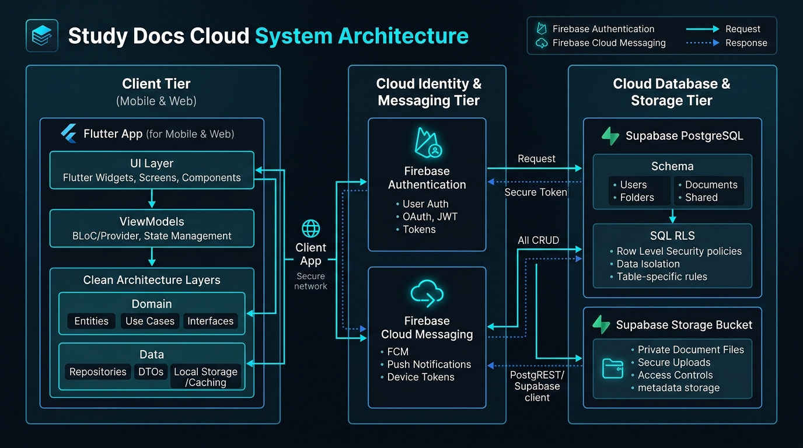
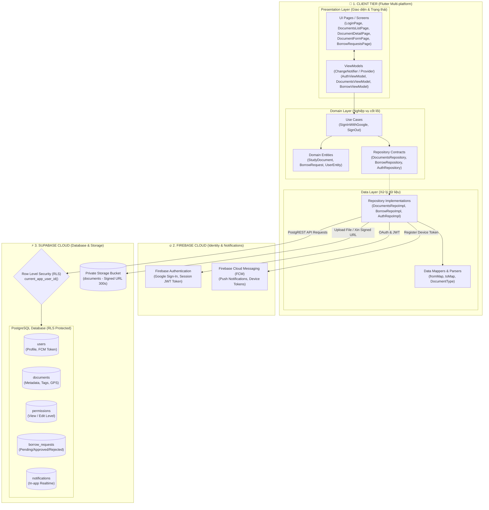
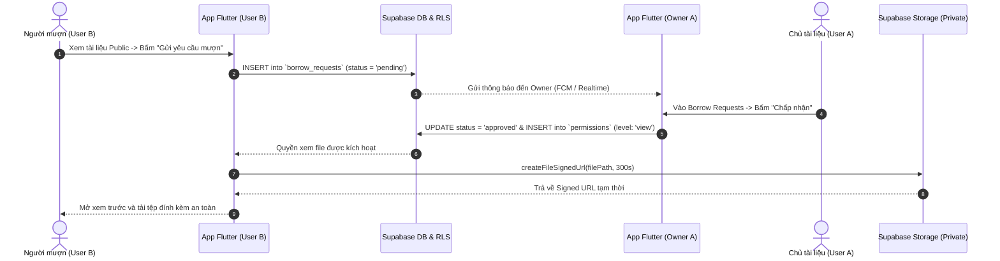

# Sơ đồ Kiến trúc Tổng thể — Study Docs Cloud

Tài liệu này tổng hợp kiến trúc hệ thống và kiến trúc mã nguồn của ứng dụng **Study Docs Cloud** (dự án nhóm N2).

---

## 1. Sơ đồ Kiến trúc Hệ thống Trực quan

*(Bạn cũng có thể mở trực tiếp file `so_do_kien_truc.html` trên trình duyệt để xem sơ đồ trực quan tương tác).*

---

## 2. Sơ đồ Cấu trúc Phân tầng (Architecture Diagram)

---

## 3. Sơ đồ Luồng Nghiệp vụ Mượn & Chia sẻ File An toàn

---

## 4. Mô hình Chi tiết 3 Tầng Hệ thống

| Tầng (Tier) | Công nghệ chính | Trách nhiệm |
| :--- | :--- | :--- |
| **Client** | Flutter (Dart), Provider, Material 3 | Responsive UI (Android, Web, Desktop), quản lý trạng thái, validation, offline-friendly UI. |
| **Identity & Messaging** | Firebase Auth & FCM | Đăng nhập Google, cấp session token, gửi push notifications khi có yêu cầu mượn tài liệu. |
| **Data & Storage** | Supabase (PostgreSQL & Storage) | Lưu trữ metadata, xử lý phân quyền bằng SQL Row Level Security (RLS), lưu trữ file riêng tư qua Signed URL. |
